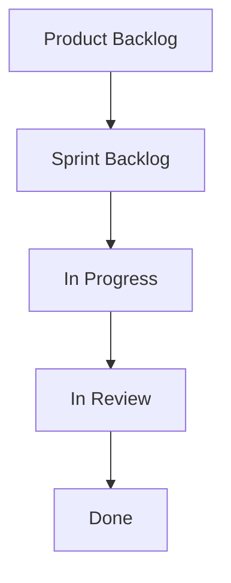

# [Thực hành] Xây dựng Product Backlog và vận hành luồng Scrum trên Trello

> 👤 **Học viên:** Đỗ Hoàng Sơn | **Mã SV:** PTIT-HCM-066
> 🏫 **Môn học:** IT206-K25-Agile-va-Scrum

---

## 📊 Sơ đồ thiết kế hệ thống (Flowchart)

> 💡 *Sơ đồ dưới đây được render tự động trực tiếp trên GitHub bằng Mermaid. Bạn cũng có thể tải file **`btth1.drawio`** trong repository này để mở và chỉnh sửa trực tiếp trên [Draw.io (diagrams.net)](https://app.diagrams.net).* 

---

## Nhiệm vụ 1: Mục tiêu và Thiết lập Board

Trong bài thực hành này, tôi đóng vai trò Product Owner của dự án GoMart - ứng dụng đi chợ hộ. Sprint 1 được lên kế hoạch kéo dài 2 tuần với team gồm tôi và 2 thành viên.

Đầu tiên, tôi tạo một Board mới trên Trello với tên 'GoMart - Scrum Board' và thiết lập quyền riêng tư là 'Private' để đảm bảo tính bảo mật cho dự án.

- Áp dụng bộ tiêu chí DEEP để sàng lọc và sắp xếp Product Backlog.
- Thao tác thành thạo trên Trello: tạo Board, List, Card, gán Label, Due date, Member và Checklist.
- Vận hành đúng luồng 5 cột chuẩn Scrum từ Product Backlog đến Done.

## Nhiệm vụ 2: Thiết lập 5 List chuẩn Scrum

Để quản lý công việc theo đúng luồng Agile/Scrum, tôi tạo chính xác 5 List trên Trello theo thứ tự từ trái sang phải như yêu cầu của bài tập.

- List 1: Product Backlog
- List 2: Sprint Backlog
- List 3: In Progress
- List 4: In Review
- List 5: Done

## Nhiệm vụ 3 & 4: Khởi tạo Product Backlog và Sắp xếp theo tiêu chí DEEP (Prioritized)

Tôi đưa 6 ý tưởng thô từ danh sách đề bài vào cột Product Backlog. Sau đó, tôi sắp xếp lại theo tiêu chí P (Prioritized) trong DEEP — ưu tiên dựa trên giá trị mang lại cho khách hàng chứ không theo thứ tự kỹ thuật.

Đồng thời, tôi gán nhãn (Label) màu cho toàn bộ 6 Card: màu đỏ cho nhóm giá trị 'Cao' và 'Rất cao', màu vàng cho 'Trung bình', và màu xanh lá cho 'Thấp'.

| Thứ tự ưu tiên | Tên Card | Giá trị mang lại | Label Trello |
| --- | --- | --- | --- |
| 1 | Giỏ hàng và đặt đơn đi chợ | Rất cao | Đỏ |
| 2 | Chọn siêu thị trong bán kính 3km | Cao | Đỏ |
| 3 | Thanh toán bằng thẻ ATM nội địa | Cao | Đỏ |
| 4 | Đăng nhập bằng Google | Trung bình | Vàng |
| 5 | Chat với người đi chợ hộ | Thấp | Xanh lá |
| 6 | Đánh giá người đi chợ hộ | Thấp | Xanh lá |

## Nhiệm vụ 5: Phân quyền thành viên trên Board

Sử dụng chức năng 'Share' của Trello, tôi mời 2 thành viên vào Board thông qua địa chỉ email phụ đã chuẩn bị sẵn và đặt tên hiển thị gợi nhớ đúng theo vai trò trong team.

- Thành viên 1: dev_backend
- Thành viên 2: qa_tester

## Nhiệm vụ 6 & 7: Chi tiết công việc và Vận hành luồng Scrum Sprint 1

Đối với Card 'Giỏ hàng và đặt đơn đi chợ', tôi mở rộng Card và thực hiện các cấu hình chi tiết:

1. Thêm Checklist có tên 'Công việc chi tiết' gồm 3 mục: 'Thiet ke UI gio hang', 'Code API tao don', 'Test luong dat don'.

2. Gán Member phụ trách cho Card, đặt Due date và thiết lập tính năng nhắc nhở trước 1 ngày.

3. Vận hành luồng Scrum: Kéo Card lần lượt qua các cột 'Sprint Backlog' -> 'In Progress'. Tại đây, tôi tiến hành tích hoàn thành 2/3 mục checklist rồi mới kéo sang 'In Review'. Sau đó, tôi tiếp tục tích nốt mục cuối cùng để đạt tỷ lệ hoàn thành checklist '3/3' rồi mới kéo sang cột 'Done'.

5 Card còn lại được giữ nguyên tại cột 'Product Backlog' nhằm tuân thủ tuyệt đối nguyên tắc cam kết phạm vi cho phép trong Sprint 1.

- Kiểm tra luồng: Card ở cột Done bắt buộc phải hiển thị trạng thái checklist 3/3 mới chuẩn quy trình nghiệm thu.
- Phạm vi Sprint 1 chỉ cam kết duy nhất 1 Card, tránh tình trạng ôm đồm nhiều việc gây vỡ kế hoạch.

## Nhiệm vụ 8: Bàn giao kết quả

Toàn bộ màn hình Board sau khi hoàn thành các bước trên đã được chụp lại và lưu trữ với tên 'gomart_sprint1_board.png' trong thư mục nộp bài của repository 'IT206-K25-Agile-va-Scrum'.

- Đảm bảo Board có đủ 5 List đúng thứ tự.
- Đảm bảo Card đứng đầu tiên đúng là 'Giỏ hàng và đặt đơn đi chợ'.
- Đảm bảo trạng thái checklist ở cột Done đạt 3/3.

---

## 📁 Danh sách tệp tin nộp bài trong Repository
- 📝 `btth1.docx`: Báo cáo tài liệu phân tích nghiệp vụ hoàn chỉnh.
- 🎨 `btth1.drawio`: File thiết kế sơ đồ chuẩn theo quy định đề bài (mở trực tiếp bằng [Draw.io](https://app.diagrams.net) hoặc Lucidchart).
